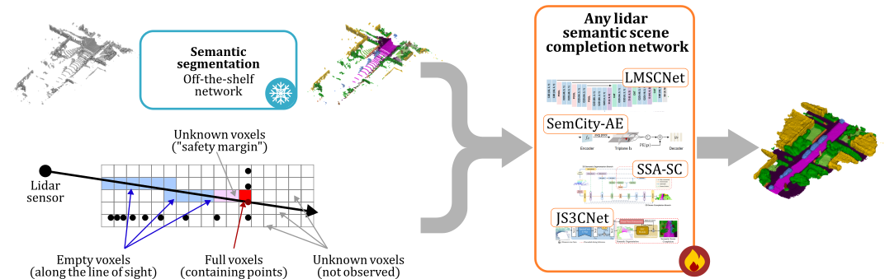

<div align="center">

# SSC-Priors: Semantic and Visibility Priors for Lidar Semantic Scene Completion

[](https://arxiv.org/abs/2606.03992)
[](https://arxiv.org/abs/2609.17413)
[](https://2026.ieeeicip.org/)

</div>

<p align="center">
  
</p>

This is the official repository of

```
Exploring Easy Boosts for Lidar Semantic Scene Completion
Tetiana Martyniuk, Jonathan Seele, Alexandre Boulch, Gilles Puy, Renaud Marlet, Raoul de Charette
IEEE ICIP 2026
```

and of its extension

```
SSC-Priors: Exploring Semantic and Visibility Priors to Boost Lidar Semantic Scene Completion
Tetiana Martyniuk, Jonathan Seele, Alexandre Boulch, Gilles Puy, Renaud Marlet, Raoul de Charette
arXiv 2026
```

We boost existing lidar semantic scene completion (SSC) networks with two simple priors,
given as input without redesigning the architecture:

- **Semantic prior**: the lidar points carry semantic pseudo-labels from an off-the-shelf
  segmentation network (here [WaffleIron](https://github.com/valeoai/WaffleIron)).
- **Visibility prior**: the input distinguishes the space observed as empty (between the
  sensor and a lidar point) from the unknown space (outside the lines of sight).

Both priors only change the input voxel grid, and hence the first layer of the network.

**Updates:**

- 09/2026: code and pretrained SemCity-AE models released for SemanticKITTI.

## Contents

1. [Overview](#1-overview)
2. [Installation](#2-installation)
3. [SemanticKITTI](#3-semantickitti)
4. [Semantic prior: WaffleIron pseudo-labels](#4-semantic-prior-waffleiron-pseudo-labels)
5. [Precomputing the network inputs](#5-precomputing-the-network-inputs)
6. [Training](#6-training)
7. [Evaluation and pretrained models](#7-evaluation-and-pretrained-models)
8. [Repository layout](#8-repository-layout)
9. [Citation](#9-citation)
10. [License](#10-license)

## 1. Overview

This release covers **SemCity-AE** (the triplane autoencoder of
[SemCity](https://github.com/zoomin-lee/SemCity)) on **SemanticKITTI**, in two configurations:

| Model | Semantic prior | Visibility prior | IoU | mIoU |
|---|---|---|:---:|:---:|
| SemCity-AE (vanilla) | – | – | 53.9 | 16.4 |
| SemCity-AE + priors | WaffleIron-TTA | dense | 57.0 | 25.9 |

<sub>SemanticKITTI validation set (sequence 08). The model with priors is trained with plain
WaffleIron pseudo-labels and evaluated with WaffleIron test-time-augmented (TTA) pseudo-labels.</sub>

The network input is a 256×256×32 voxel grid (0.2 m voxels) in front of the sensor. Each
voxel holds one value, embedded by the first layer of the network:

| Value | Semantic prior `none` | Semantic prior `waffleiron` / `waffleiron_tta` |
|---|---|---|
| `0` | empty (visibility `none`) / observed empty (visibility `dense`) | same |
| `1..19` | `1` = occupied | occupied, with the majority pseudo-label class of its points |
| `255` | unknown (visibility `dense`) | unknown (visibility `dense`), or occupied by points without a valid class |

With the **dense visibility prior**, free-space samples are placed every 20 cm along each
lidar ray, from the sensor to the point. A voxel crossed by a ray that contains no lidar
point is *observed empty* (`0`); a voxel that is neither occupied nor crossed is *unknown*
(`255`). Without it (visibility `none`), every non-occupied voxel is `0`. See
[`priors.py`](priors.py).

The workflow is:

```
SemanticKITTI ──► WaffleIron pseudo-labels (§4) ──► precomputed inputs (§5) ──► training (§6) ──► evaluation (§7)
```

The vanilla model skips §4, and §5 is optional for it.

## 2. Installation

The code was developed and tested with **Python 3.10**, **PyTorch 2.1.0 (CUDA 11.8)** on an
**NVIDIA A100 (40 GB)** GPU.

```
git clone https://github.com/astra-vision/SSC-Priors.git
cd SSC-Priors
conda create -n ssc-priors python=3.10 -y
conda activate ssc-priors
pip install torch==2.1.0 --index-url https://download.pytorch.org/whl/cu118
pip install -r requirements.txt
```

If your CUDA version differs, pick the matching PyTorch 2.x build from
[pytorch.org](https://pytorch.org/get-started/locally/).

All commands below are run from the root of this repository, in this environment.

## 3. SemanticKITTI

Download from the [SemanticKITTI website](http://www.semantic-kitti.org/dataset.html#download):

- the KITTI odometry Velodyne point clouds (`data_odometry_velodyne.zip`, 80 GB),
- the SemanticKITTI label data (`data_odometry_labels.zip`),
- the SemanticKITTI voxel data (`data_odometry_voxels.zip`).

Unzip them into the same directory, `<KITTI_ROOT>`, to obtain:

```
<KITTI_ROOT>/dataset/sequences/
├── 00/
│   ├── velodyne/000000.bin ...          # lidar scans
│   ├── labels/000000.label ...          # point labels (read by WaffleIron's data loader)
│   └── voxels/000000.{bin,label,invalid,occluded} ...   # SSC inputs and ground truth, every 5th scan
├── ...
└── 10/
```

Sequences `00`–`07`, `09` and `10` are used for training and sequence `08` for validation.
As in the SemanticKITTI SSC benchmark, the scans with voxel ground truth (every 5th scan)
are used: 3,834 training scans, and 815 validation scans.

> SemanticKITTI is released under **CC BY-NC-SA 4.0** (non-commercial, share-alike). Models
> trained on it, including the checkpoints of this repository, inherit these terms
> (see [§10](#10-license)).

## 4. Semantic prior: WaffleIron pseudo-labels

*Skip this section for the vanilla model.*

The semantic prior uses the predictions of the public SemanticKITTI checkpoint of
[WaffleIron](https://github.com/valeoai/WaffleIron) (trained on the SemanticKITTI training
sequences). Two sets of pseudo-labels are needed, stored side by side in `<PSEUDO_LABELS_ROOT>`:

```
<PSEUDO_LABELS_ROOT>/
├── waffleiron/sequences/{00..10}/predictions/*.label       # plain WaffleIron: training (+ per-epoch validation)
└── waffleiron_tta/sequences/08/predictions/*.label          # WaffleIron with 12-vote TTA: final evaluation
```

Each `.label` file holds one `uint32` SemanticKITTI label per point of the scan, like the
SemanticKITTI point labels.

**4.1. Get WaffleIron.** Clone the official repository (release `v0.3.1`), outside of this
one, and download its pretrained SemanticKITTI model. WaffleIron is used unmodified, in the
`ssc-priors` environment, and does not need to be pip-installed.

```
git clone --branch v0.3.1 https://github.com/valeoai/WaffleIron.git <WAFFLEIRON_REPO>
cd <WAFFLEIRON_REPO>
wget https://github.com/valeoai/WaffleIron/releases/download/v0.2.0/waffleiron_kitti.tar.gz
tar -xvzf waffleiron_kitti.tar.gz
cd -
```

This creates `<WAFFLEIRON_REPO>/pretrained_models/WaffleIron-48-256__kitti/ckpt_last.pth`.

**4.2. Plain WaffleIron on sequences 00–10.**
[`tools/generate_waffleiron_labels.py`](tools/generate_waffleiron_labels.py) runs WaffleIron
on the SSC scans only. Unlike WaffleIron's `eval_kitti.py`, it also runs on the training
sequences, with the same deterministic inference as on the validation sequence.

```
python tools/generate_waffleiron_labels.py --waffleiron_root <WAFFLEIRON_REPO> --kitti_root <KITTI_ROOT> --output_dir <PSEUDO_LABELS_ROOT>/waffleiron
```

**4.3. WaffleIron-TTA on sequence 08.** Test-time augmentation averages the per-point
softmax of 12 randomly augmented passes (WaffleIron's own TTA recipe, `--num_votes 12`)
before taking the argmax.

```
python tools/generate_waffleiron_labels.py --waffleiron_root <WAFFLEIRON_REPO> --kitti_root <KITTI_ROOT> --output_dir <PSEUDO_LABELS_ROOT>/waffleiron_tta --sequences 08 --num_votes 12 --batch_size 12
```

Lower `--batch_size` (it must divide `--num_votes`) if you run out of GPU memory. Both
commands accept `--skip_existing` to resume an interrupted run, and `--limit 5` for a quick
test.

> **Note.** WaffleIron's TTA is random (random rotations, flips and scaling, and active
> DropPath), so regenerated TTA pseudo-labels are not bit-identical to ours. On our side,
> two TTA generations gave the same SSC scores within ±0.1 mIoU.

## 5. Precomputing the network inputs

The dense visibility prior samples every lidar ray every 20 cm, which takes about 1 s per scan
on CPU and much less on a GPU. For training, precompute the inputs once on the GPU:

```
python precompute_priors.py --kitti_root <KITTI_ROOT> --pseudo_labels_root <PSEUDO_LABELS_ROOT> --semantics waffleiron --visibility dense --output_root <PRECOMPUTED_ROOT>
```

This writes `<PRECOMPUTED_ROOT>/waffleiron/dense/{seq}/{frame}.npy` for the training scans and
the validation scans (used for validation after each epoch). For the final evaluation, also
precompute the inputs with the WaffleIron-TTA pseudo-labels:

```
python precompute_priors.py --kitti_root <KITTI_ROOT> --pseudo_labels_root <PSEUDO_LABELS_ROOT> --semantics waffleiron_tta --visibility dense --splits val --output_root <PRECOMPUTED_ROOT>
```

The run is resumable: existing files are skipped. When `--precomputed_root` is not given to
`train.py` or `eval.py`, the inputs are built on the fly on CPU by the data loader workers,
which is fast for the vanilla input (`--visibility none`). With the dense visibility prior,
this is fine for evaluation (815 scans, 5-10 minutes with 8 workers) but slows down training.

## 6. Training

Training runs for 50 epochs with Adam (learning rate 1e-4, cosine annealing), batch size 1,
cross-entropy + Lovász-softmax losses and random flips. The model is validated on sequence 08
after each epoch. The paper reports the last epoch.

**SemCity-AE + priors** (trained with plain WaffleIron pseudo-labels):

```
python train.py --kitti_root <KITTI_ROOT> --semantics waffleiron --visibility dense --pseudo_labels_root <PSEUDO_LABELS_ROOT> --precomputed_root <PRECOMPUTED_ROOT> --save_path runs/semcity_ae_wi_dense
```

**Vanilla SemCity-AE**:

```
python train.py --kitti_root <KITTI_ROOT> --semantics none --visibility none --save_path runs/semcity_ae_vanilla
```

`--save_path` receives `training_args.json`, `training_log.txt`, TensorBoard logs (`tb/`) and
`checkpoints/last.pt` (plus `checkpoints/best_miou.pt`). Resume an interrupted training with
`--resume <save_path>/checkpoints/last.pt`. For a quick end-to-end test, add
`--epochs 1 --max_iters_per_epoch 20`.

**Other prior combinations.** `--semantics {none, waffleiron}` and `--visibility {none, dense}`
can be combined freely, e.g. the dense visibility prior alone with `--semantics none --visibility dense`.
Precompute the matching inputs first (§5) with the same `--semantics` and `--visibility`.

## 7. Evaluation and pretrained models

**Pretrained models.** Download the checkpoints from the
[v1.0 release](https://github.com/astra-vision/SSC-Priors/releases/tag/v1.0) into `checkpoints/`:

| Model | Checkpoint | IoU | mIoU |
|---|---|:---:|:---:|
| SemCity-AE (vanilla) | [`semcity_ae_vanilla.pt`](https://github.com/astra-vision/SSC-Priors/releases/download/v1.0/semcity_ae_vanilla.pt) | 53.9 | 16.4 |
| SemCity-AE + priors (WaffleIron-TTA, dense) | [`semcity_ae_wi_tta_dense.pt`](https://github.com/astra-vision/SSC-Priors/releases/download/v1.0/semcity_ae_wi_tta_dense.pt) | 57.0 | 25.9 |

```
mkdir -p checkpoints
wget -P checkpoints https://github.com/astra-vision/SSC-Priors/releases/download/v1.0/semcity_ae_vanilla.pt
wget -P checkpoints https://github.com/astra-vision/SSC-Priors/releases/download/v1.0/semcity_ae_wi_tta_dense.pt
```

A checkpoint stores the priors its model was trained with. `eval.py` builds the matching
input, so only the semantic prior can be changed at evaluation time: a model trained with
`waffleiron` can be evaluated with `waffleiron_tta`.

**SemCity-AE + priors**, evaluated with WaffleIron-TTA pseudo-labels (57.0 IoU / 25.9 mIoU):

```
python eval.py --kitti_root <KITTI_ROOT> --checkpoint checkpoints/semcity_ae_wi_tta_dense.pt --semantics waffleiron_tta --precomputed_root <PRECOMPUTED_ROOT>
```

**Vanilla SemCity-AE** (53.9 IoU / 16.4 mIoU):

```
python eval.py --kitti_root <KITTI_ROOT> --checkpoint checkpoints/semcity_ae_vanilla.pt
```

The same commands evaluate your own models (`<save_path>/checkpoints/last.pt`). Without
`--precomputed_root`, the inputs are built on the fly (pass `--pseudo_labels_root` for the
semantic prior). Add `--save_predictions <OUTPUT_DIR>` to write the predicted grids as
`<OUTPUT_DIR>/sequences/08/predictions/*.label`, the format of the official
[semantic-kitti-api](https://github.com/PRBonn/semantic-kitti-api) `evaluate_completion.py`.

`tools/export_checkpoint.py` turns a training checkpoint into a lightweight checkpoint
(weights and config only) like the released ones.

## 8. Repository layout

```
priors.py                            # semantic and visibility priors: scan -> network input
precompute_priors.py                 # §5: precompute the network inputs
train.py                             # §6: training
eval.py                              # §7: evaluation on SemanticKITTI val
common.py                            # model config, checkpoints, prediction helpers
losses.py                            # Lovász-softmax loss
metrics.py                           # SSC IoU / mIoU
data/semantic_kitti.py               # SemanticKITTI SSC dataset
data/query.py                        # query points of the implicit decoder
data/semantic-kitti.yaml             # classes, label mapping and splits
models/networks.py, models/blocks.py # SemCity-AE (triplane encoder + MLP decoder)
tools/generate_waffleiron_labels.py  # §4: WaffleIron (-TTA) pseudo-labels
tools/export_checkpoint.py           # lightweight checkpoint export
```

## 9. Citation

If you use this code, please cite our papers:

```bibtex
@inproceedings{martyniuk2026easy,
  title     = {Exploring Easy Boosts for Lidar Semantic Scene Completion},
  author    = {Martyniuk, Tetiana and Seele, Jonathan and Boulch, Alexandre and Puy, Gilles and Marlet, Renaud and de Charette, Raoul},
  booktitle = {IEEE International Conference on Image Processing (ICIP)},
  year      = {2026}
}

@article{martyniuk2026sscpriors,
  title   = {{SSC-Priors}: Exploring Semantic and Visibility Priors to Boost Lidar Semantic Scene Completion},
  author  = {Martyniuk, Tetiana and Seele, Jonathan and Boulch, Alexandre and Puy, Gilles and Marlet, Renaud and de Charette, Raoul},
  journal = {arXiv preprint arXiv:2609.17413},
  year    = {2026}
}
```

## 10. License

Copyright (c) 2026 Valeo.

This project comes with **three distinct sets of terms**:

- **Source code**: **Apache License, Version 2.0** (see [`License.txt`](License.txt) and
  [`NOTICE`](NOTICE)). This covers everything in this repository.
- **Pretrained checkpoints** (released via GitHub Releases): **CC BY-NC-SA 4.0**, the license
  of the SemanticKITTI dataset (non-commercial research use only). The checkpoints are
  trained on SemanticKITTI and are therefore adaptations of CC BY-NC-SA 4.0 data; under the
  ShareAlike term they inherit the same terms and **may not be used commercially**.
- **SemanticKITTI dataset** (downloaded separately, not redistributed here): **CC BY-NC-SA 4.0**,
  as set by its authors.

The code builds upon third-party open-source software: the MIT-licensed SemCity codebase for
the triplane autoencoder, the Lovász-softmax loss, WaffleIron and the SemanticKITTI
development kit. Their copyright and license notices are summarized in
[`THIRD-PARTY-NOTICES.txt`](THIRD-PARTY-NOTICES.txt), with the license texts in
[`licenses/`](licenses/).

> **Commercial use.** The released weights derive from the non-commercial SemanticKITTI
> dataset and cannot be used commercially. Commercial use requires retraining on data cleared
> for commercial use, or a commercial license from the SemanticKITTI authors.

## Acknowledgements

The triplane autoencoder builds on [SemCity](https://github.com/zoomin-lee/SemCity), and the
semantic prior uses [WaffleIron](https://github.com/valeoai/WaffleIron). We thank their authors
for releasing their code.
